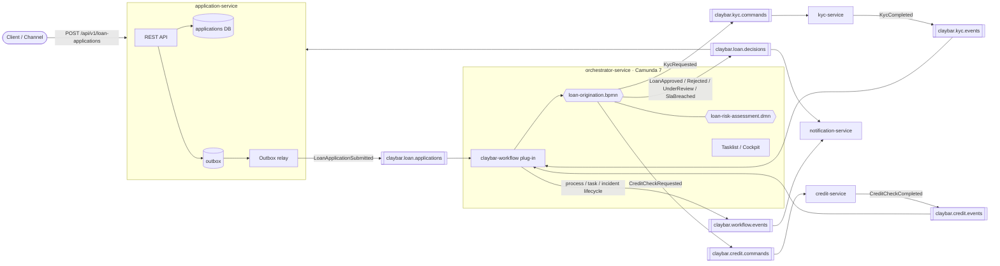

# Claybar Financials — Workflow Orchestration & Event-Driven Microservices

Loan origination for Claybar Financials, orchestrated by **Camunda 7 (BPMN + DMN)** and executed by
**Spring Boot microservices** that talk only through **Apache Kafka**. The Camunda ↔ Kafka integration is
packaged as a reusable **plug-in** (a Spring Boot starter plus a Camunda `ProcessEnginePlugin`), so any other
Camunda application can adopt the same pattern by adding one dependency.



## Documentation

[Architecture docs](docs/architecture/README.md): business flows, C4 model, 4+1 views and low-level design, all with diagrams. Decisions are in [docs/adr](docs/adr).

## The process

`services/orchestrator-service/src/main/resources/bpmn/loan-origination.bpmn` (open it in Camunda Modeler, or see it live with instance counts in Cockpit → Processes → Loan origination):

1. **Message start** `LoanApplicationSubmitted`. The business key is the application id.
2. **Parallel KYC and credit checks.** Each one is a *send task* (Kafka command) followed by a *receive task*
   (Kafka reply), with an **SLA boundary timer** (`${loanSla.kycTimeout}`). A timeout does not fail the
   application. It marks the check `TIMEOUT`, and the DMN then routes the case to a human.
3. **DMN `loan-risk-assessment`** (hit policy FIRST): `APPROVE` / `REVIEW` / `REJECT` from KYC status, credit
   status, score, loan-to-income ratio and amount. Credit Risk owns this table and can change it without Java changes.
4. **Manual underwriting** user task (`underwriters` group) with a **non-interrupting SLA timer** that
   publishes `UnderwritingSlaBreached` to operations.
5. The decision is published to `claybar.loan.decisions`.

## Modules

| Module | Purpose |
|---|---|
| [`claybar-events`](claybar-events) | Event contract (`EventEnvelope`, `Topics`, `EventTypes`), JSON codec, `EventPublisher`, shared Kafka error handling (exponential retry, then `<topic>.DLT`; poison messages go straight to the DLT), topic provisioning. Auto-configured. |
| [`claybar-workflow-spring-boot-starter`](claybar-workflow-spring-boot-starter) | **The plug-in.** `kafkaCommandDelegate` for BPMN send tasks, `WorkflowEventCorrelator` (Kafka event → start/correlate, idempotent), and `ClaybarKafkaEventsProcessEnginePlugin` (engine lifecycle → Kafka). |
| [`orchestrator-service`](services/orchestrator-service) `:8080` | Camunda engine, webapps (Cockpit/Tasklist/Admin), REST API (basic auth), BPMN and DMN, SLA configuration. |
| [`application-service`](services/application-service) `:8081` | Intake REST API (OpenAPI), system of record, **transactional outbox**, idempotent decision projection, `Idempotency-Key` support. Flyway, PostgreSQL. |
| [`kyc-service`](services/kyc-service) `:8082` | Sanctions / PEP / age screening (`VERIFIED`, `FAILED`, `REFER`). |
| [`credit-service`](services/credit-service) `:8083` | Credit-bureau port with a deterministic simulator (score, risk band, DTI). |
| [`notification-service`](services/notification-service) `:8084` | Customer e-mails and ops alerts (decisions, SLA breaches, workflow incidents). The sender is a port. |

## Quick start

Prerequisites: JDK 21, Maven 3.9+, Docker.

```bash
make build   # compile + 44 tests (unit, DMN, BPMN process, Spring MVC, embedded Kafka)
```

```bash
make up      # jars -> images -> Kafka (KRaft) + PostgreSQL + Kafka UI + 5 services, waits until healthy
```

```bash
make demo    # one application per path: auto-approve, manual review, auto-reject, sanctions hit
```

| UI | URL |
|---|---|
| Camunda Cockpit / Tasklist | http://localhost:8080/camunda (admin / admin) |
| Application API (Swagger UI) | http://localhost:8081/swagger-ui.html |
| Kafka UI | http://localhost:8090 |
| Metrics (any service) | `/actuator/prometheus` |

Demo national-id prefixes drive the simulated bureau: `PRIME-*` → 800, `NEAR-*` → 650, `SUB-*` → 480.
Applicant name `Ivan Sanctioned` triggers a sanctions hit. In compose the SLAs are shortened (KYC/credit 2 min,
underwriting 5 min) so you can watch the timer paths fire. Stop the stack with `make down`.

Complete a manual review from the command line:

```bash
TASK=$(curl -s -u admin:admin "localhost:8080/engine-rest/task?processInstanceBusinessKey=<APP-ID>" | jq -r '.[0].id')
curl -u admin:admin -X POST localhost:8080/engine-rest/task/$TASK/complete -H 'Content-Type: application/json' \
  -d '{"variables":{"underwritingApproved":{"value":true},"underwriterComment":{"value":"Payslips verified"}}}'
```

## Using the workflow plug-in in another application

```xml
<dependency>
  <groupId>com.claybar</groupId>
  <artifactId>claybar-workflow-spring-boot-starter</artifactId>
  <version>1.0.0-SNAPSHOT</version>
</dependency>
```

```yaml
claybar:
  workflow:
    inbound-topics: claybar.payments.events,claybar.fraud.events   # events routed into the engine
    start-events: PaymentInitiated                                   # these start a process (message start event)
    lifecycle-events.enabled: true                                   # stream process/task/incident events to Kafka
```

In BPMN, publish with a send task and wait with a receive task whose message name equals the reply's `eventType`:

```xml
<bpmn:sendTask id="RequestFraudCheck" camunda:asyncBefore="true" camunda:delegateExpression="${kafkaCommandDelegate}">
  <bpmn:extensionElements><camunda:inputOutput>
    <camunda:inputParameter name="topic">claybar.fraud.commands</camunda:inputParameter>
    <camunda:inputParameter name="eventType">FraudCheckRequested</camunda:inputParameter>
    <camunda:inputParameter name="payloadVariables">amount,iban</camunda:inputParameter>
  </camunda:inputOutput></bpmn:extensionElements>
</bpmn:sendTask>
<bpmn:receiveTask id="AwaitFraudCheck" messageRef="Msg_FraudCheckCompleted" camunda:asyncAfter="true" />
```

Every bean is `@ConditionalOnMissingBean`, so you can override any one of them. The engine plugin is a plain
`ProcessEnginePlugin`, so it also works on a shared engine outside Spring Boot.
See [docs/plugin-guide.md](docs/plugin-guide.md) for the full contract.

## Production design

| Concern | How it is handled |
|---|---|
| Lost or phantom events | The application service uses a **transactional outbox**. The engine publishes **after commit** and relies on BPMN SLA timers to cover a failed send. [ADR-0003](docs/adr/0003-delivery-guarantees.md) |
| Race: reply arrives before the process waits | The send task is `asyncBefore` and the publish happens after commit, so the receive-task subscription always exists first. |
| Duplicates (at-least-once) | Duplicate starts are caught through the business-key index. Duplicate replies find no subscription and are acknowledged. The projection keeps a `processed_event` table, notifications keep an LRU. KYC and credit are deterministic. |
| Ordering | The Kafka key is the application id, so each application's events stay in order. The outbox relay stops at the first failure. Final statuses are sticky. |
| Poison messages | `NonRetryableEventException` / deserialisation errors → DLT immediately. Everything else → exponential back-off (3 attempts) → DLT. The DLT keeps the source partition. |
| Concurrency in the engine | Receive tasks are `asyncAfter`, so the parallel join runs in jobs and optimistic-locking conflicts are retried by the job executor. |
| Variable safety | Only scalars become process variables; nested data is stored as JSON strings. `javaSerializationFormatEnabled=false`. |
| Security | Camunda REST requires HTTP Basic (it is open by default). The API response omits national id and date of birth. The container runs as a non-root user. Credentials come from env vars. |
| Operability | Actuator liveness/readiness probes, Prometheus metrics (`claybar.workflow.inbound{outcome}`, `claybar.outbox.pending`, bureau latency histogram, KYC outcomes), the correlation id is in every log line, lifecycle events stream to Kafka, Cockpit handles incidents. |
| History growth | `historyTimeToLive=P180D` is enforced, with a nightly cleanup window. |

### Before going live (not in scope of this repo)

- **Camunda 7 CE is end-of-life** (October 2025). Run it on Camunda 7 Enterprise, or plan a migration to Camunda 8
  or the community fork Operaton. Only the plug-in touches engine APIs, which limits the blast radius
  ([ADR-0001](docs/adr/0001-camunda-7-embedded-engine.md)).
- Kafka: replication factor 3, `min.insync.replicas=2`, TLS/SASL, ACLs per service, a schema registry if
  payloads grow.
- Identity: LDAP/SSO for Camunda (`claybar.demo.seed-identities=false`), OAuth2 on the application API.
- Real KYC and bureau adapters with circuit breakers. A DLT replay tool and alerts on DLT depth.

## Repository layout

```
claybar-events/                          shared event contract + Kafka plumbing
claybar-workflow-spring-boot-starter/    Camunda <-> Kafka plug-in
services/*-service/                      deployable Spring Boot services
docs/adr/                                architecture decision records
docker-compose.yml, Dockerfile, Makefile local production-like stack
scripts/demo.sh                          end-to-end demo
```
