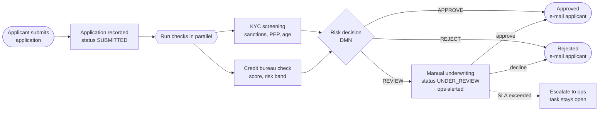
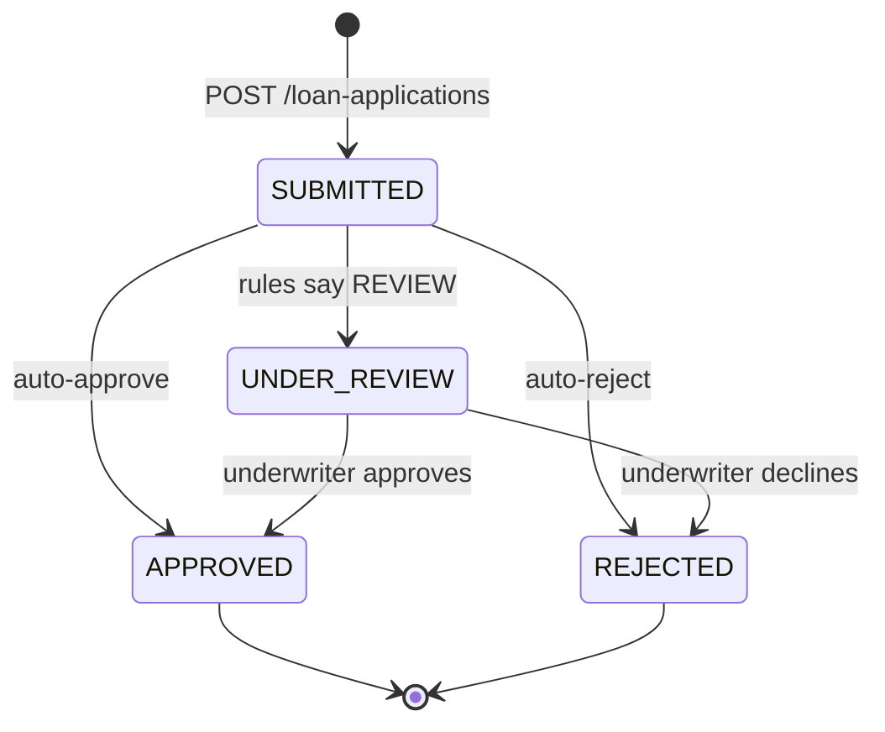
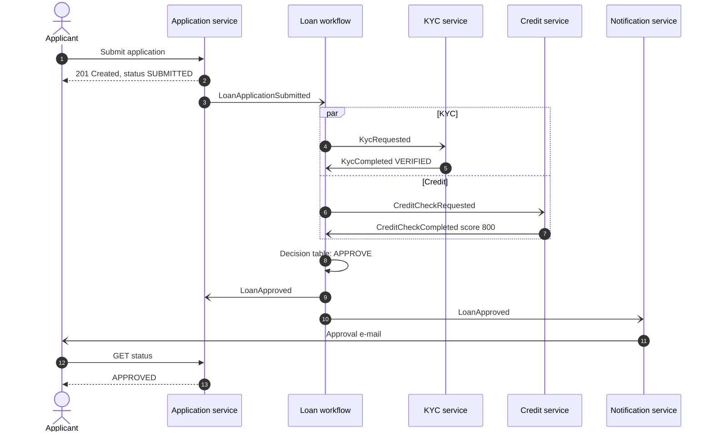
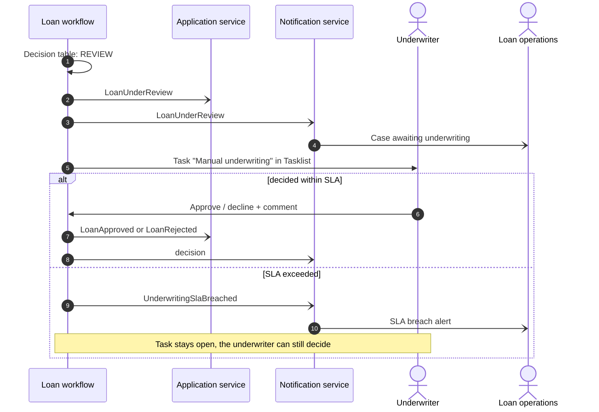

# 1. Business flows

How a loan application moves from submission to decision. This page is for product owners, credit risk
and operations; the technical views follow in [C4](02-c4-model.md), [4+1](03-4plus1-views.md) and [LLD](04-lld.md).

## 1.1 Actors

| Actor | Role in the flow |
|---|---|
| **Applicant** | Submits an application through a channel (web, mobile, broker) and receives the decision by e-mail. |
| **Underwriter** | Decides borderline cases in Camunda Tasklist (`underwriters` group). |
| **Loan operations** | Receives alerts: cases awaiting review, SLA breaches, workflow incidents. |
| **Credit risk** | Owns the decision table (DMN) that sets approve / review / reject rules. |
| **KYC provider**, **Credit bureau** | External checks (simulated in this repo). |

## 1.2 End-to-end flow

## 1.3 Application status lifecycle

The status the applicant (and the API) sees. Final states never change, even if a late event arrives.

## 1.4 Decision rules (owned by Credit Risk)

Evaluated top to bottom; the first matching rule wins (`loan-risk-assessment.dmn`, hit policy FIRST).
Loan-to-income = loan amount ÷ annual income.

| # | KYC | Credit check | Score | Loan-to-income | Amount | Decision | Why |
|---|---|---|---|---|---|---|---|
| 1 | FAILED | – | – | – | – | **REJECT** | Sanctions hit, under age or missing identity |
| 2 | TIMEOUT | – | – | – | – | REVIEW | KYC provider did not answer in time |
| 3 | – | TIMEOUT | – | – | – | REVIEW | Bureau did not answer in time |
| 4 | – | – | < 550 | – | – | **REJECT** | Sub-prime |
| 5 | – | – | – | > 1.0 | – | **REJECT** | Loan exceeds annual income |
| 6 | VERIFIED | COMPLETED | ≥ 700 | ≤ 0.4 | ≤ 50,000 | **APPROVE** | Prime, affordable, within auto-approval limit |
| 7 | – | – | – | – | – | REVIEW | Everything else |

KYC outcomes: `VERIFIED` (clean), `FAILED` (hard stop), `REFER` (politically exposed person, falls through to rule 7 → human review).

## 1.5 Service levels

| SLA | Default | On breach |
|---|---|---|
| KYC answer | 10 min | Check marked `TIMEOUT` → case goes to an underwriter (never auto-rejected for a provider outage) |
| Credit bureau answer | 10 min | Same as above |
| Underwriting decision | 2 days | Ops alerted (`UnderwritingSlaBreached`); the task stays with the underwriter |

All three are configuration (`claybar.loan.sla.*`), not code. The local Docker stack shortens them to 2 / 2 / 5 minutes.

## 1.6 Scenarios

### Happy path — automatic approval

### Manual underwriting

### Exception paths

| Situation | What happens | Applicant impact |
|---|---|---|
| Sanctions match | KYC `FAILED` → rule 1 | Rejected, no human time spent |
| KYC or bureau outage | SLA timer fires → `TIMEOUT` → REVIEW | Decision delayed, not lost |
| Same request sent twice (client retry) | `Idempotency-Key` returns the original application | One application |
| Message delivered twice (Kafka redelivery) | Ignored by every consumer | No duplicate e-mails or status changes |
| Malformed message | Parked on a dead-letter topic for investigation | If it was a KYC/credit reply, the SLA timer sends the case to review |
| Technical failure inside the workflow | Camunda incident, visible in Cockpit, ops alerted | Case pauses until ops retries it |
