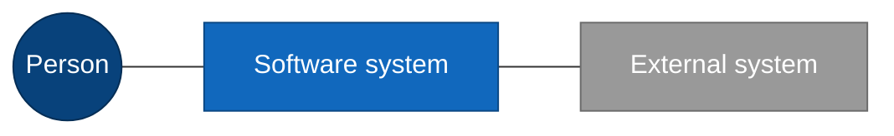
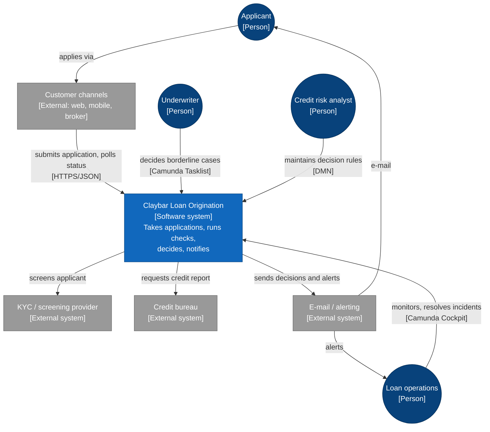
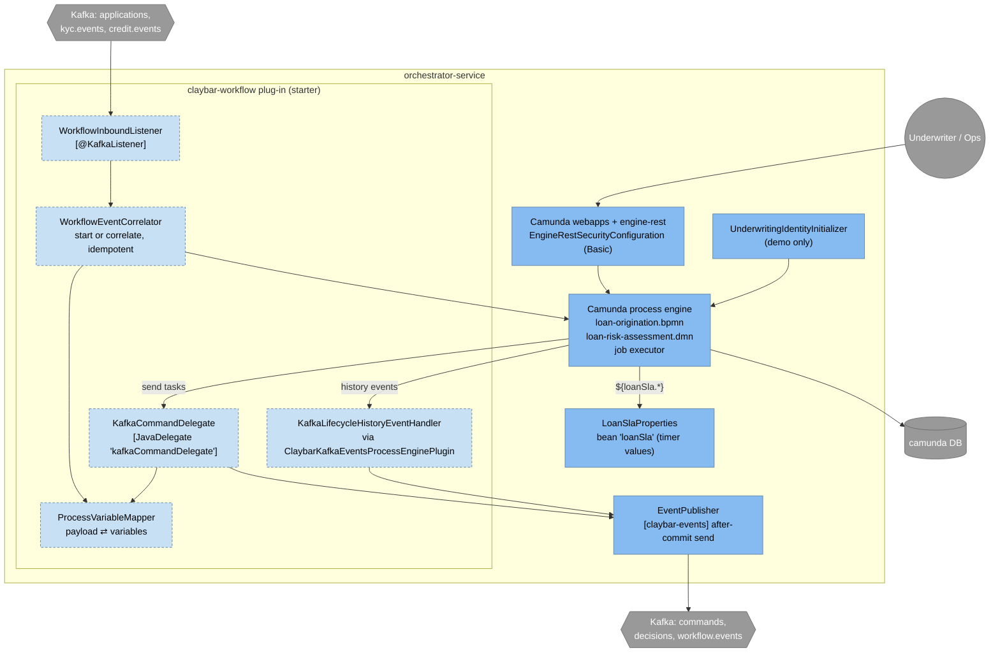
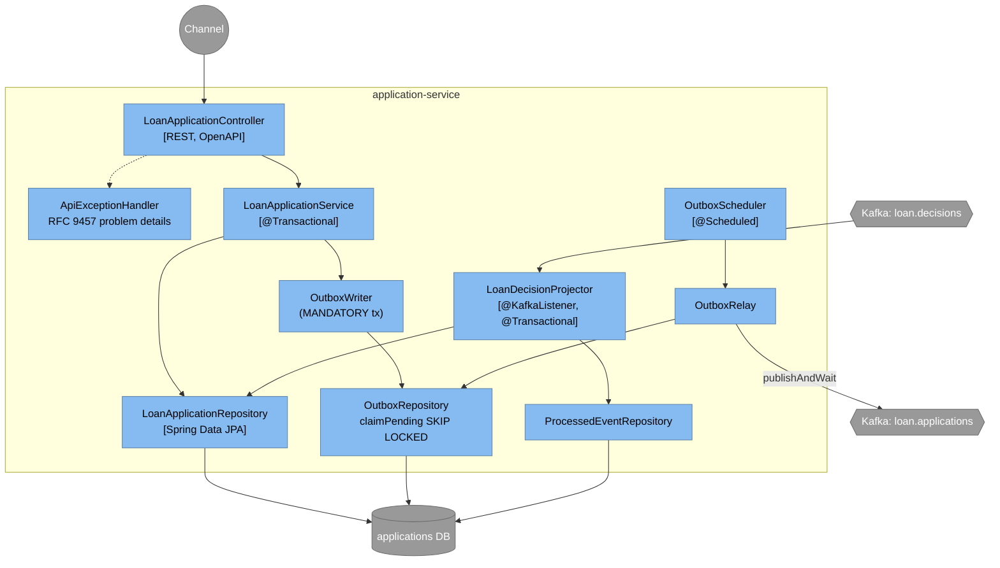
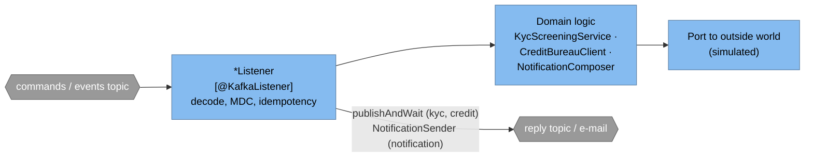
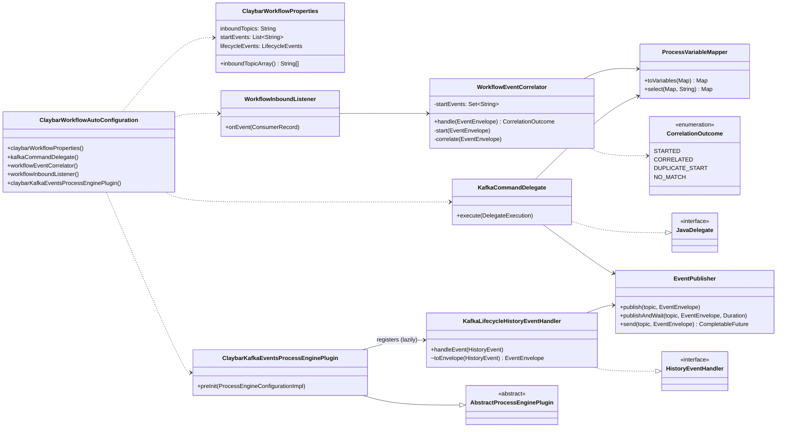

# 2. C4 model

Four zoom levels ([c4model.com](https://c4model.com)): context → containers → components → code.
Diagrams use Mermaid flowcharts with C4 notation: **blue** = our software, **grey** = external, cylinders = data stores,
`[Container: technology]` in each box.

## Level 1 — System context

> In this repository the KYC provider, credit bureau and e-mail gateway are simulated inside the KYC, credit and
> notification services behind ports (`KycScreeningService`, `CreditBureauClient`, `NotificationSender`).

## Level 2 — Containers

```mermaid
flowchart TB
    classDef person fill:#08427b,color:#fff,stroke:#052e56
    classDef container fill:#438dd5,color:#fff,stroke:#2e6295
    classDef db fill:#438dd5,color:#fff,stroke:#2e6295
    classDef bus fill:#85bbf0,color:#000,stroke:#5d82a8
    classDef ext fill:#999,color:#fff,stroke:#6b6b6b

    channel["Customer channels<br/>[External]"]:::ext
    staff(("Underwriter / Ops<br/>[Person]")):::person

    subgraph claybar["Claybar Loan Origination"]
        app["application-service<br/>[Container: Spring Boot 3.3]<br/>Intake API, system of record,<br/>outbox, status projection"]:::container
        appdb[("applications DB<br/>[PostgreSQL 16]<br/>loan_application, outbox_event,<br/>processed_event")]:::db
        orch["orchestrator-service<br/>[Container: Spring Boot + Camunda 7.22]<br/>BPMN/DMN engine, Tasklist,<br/>Cockpit, REST, workflow plug-in"]:::container
        camdb[("camunda DB<br/>[PostgreSQL 16]<br/>runtime + history")]:::db
        kafka{{"Event backbone<br/>[Apache Kafka 3.8, KRaft]<br/>7 topics + DLTs"}}:::bus
        kyc["kyc-service<br/>[Container: Spring Boot]<br/>Sanctions / PEP / age"]:::container
        credit["credit-service<br/>[Container: Spring Boot]<br/>Bureau adapter"]:::container
        notif["notification-service<br/>[Container: Spring Boot]<br/>Customer e-mails, ops alerts"]:::container
    end

    channel -->|"REST /api/v1/loan-applications"| app
    staff -->|"HTTPS /camunda"| orch
    app -->|"JPA / Flyway"| appdb
    orch -->|JDBC| camdb
    app <-->|"publishes LoanApplicationSubmitted<br/>consumes loan.decisions"| kafka
    orch <-->|"commands, decisions, lifecycle<br/>consumes applications, kyc/credit events"| kafka
    kyc <-->|"kyc.commands → kyc.events"| kafka
    credit <-->|"credit.commands → credit.events"| kafka
    notif -->|"consumes loan.decisions, workflow.events"| kafka
```

Rules visible at this level:

- **No service calls another service.** All interaction goes through Kafka; the only synchronous entry points are the
  intake API and the Camunda UIs/REST.
- **Database per service.** Only the application service and the orchestrator hold state; KYC, credit and
  notification are stateless.

### Topic ownership

| Topic | Producer | Consumers |
|---|---|---|
| `claybar.loan.applications` | application-service (outbox) | orchestrator |
| `claybar.kyc.commands` | orchestrator | kyc-service |
| `claybar.kyc.events` | kyc-service | orchestrator |
| `claybar.credit.commands` | orchestrator | credit-service |
| `claybar.credit.events` | credit-service | orchestrator |
| `claybar.loan.decisions` | orchestrator | application-service, notification-service |
| `claybar.workflow.events` | orchestrator (engine plug-in) | notification-service (+ any analytics) |
| `<topic>.DLT` | shared error handler | operators |

## Level 3 — Components

### orchestrator-service

### application-service

### kyc / credit / notification services

Same shape, no database:

## Level 4 — Code (the workflow plug-in)

