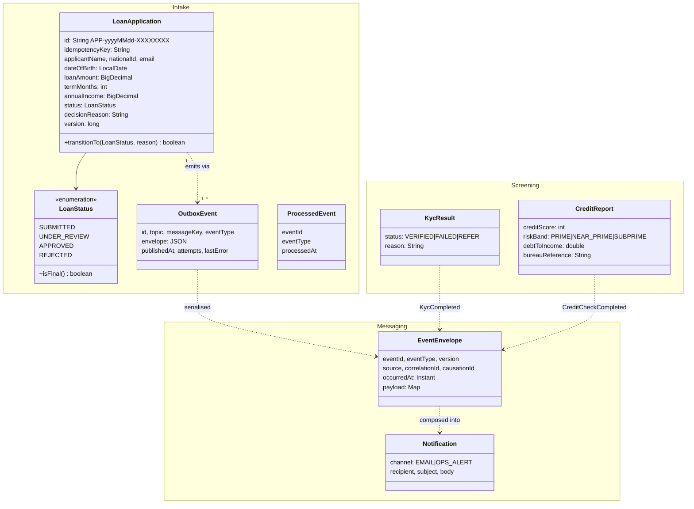
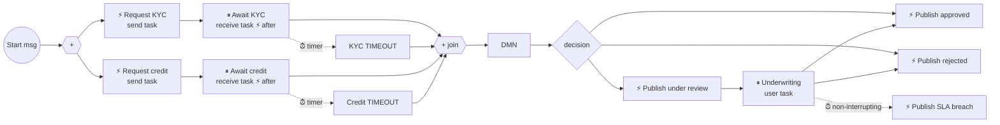
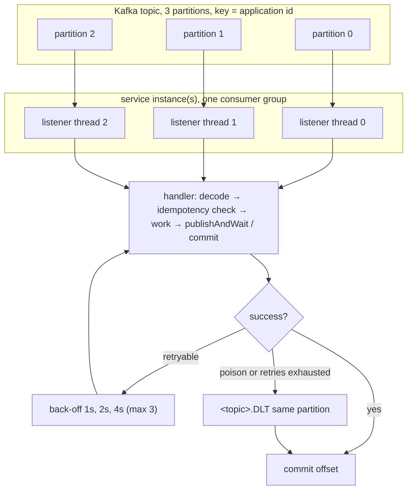
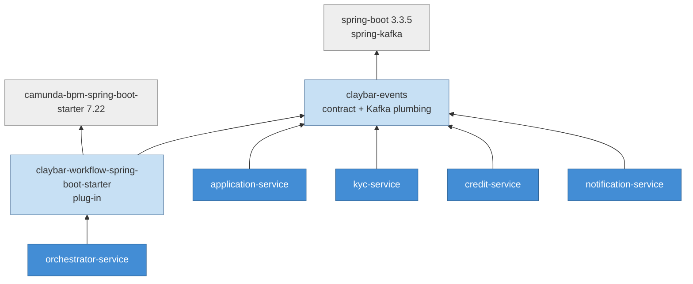
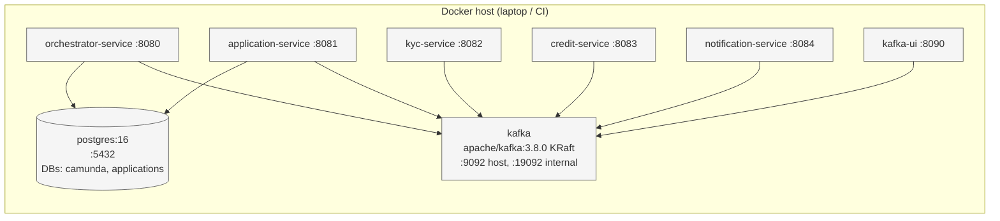
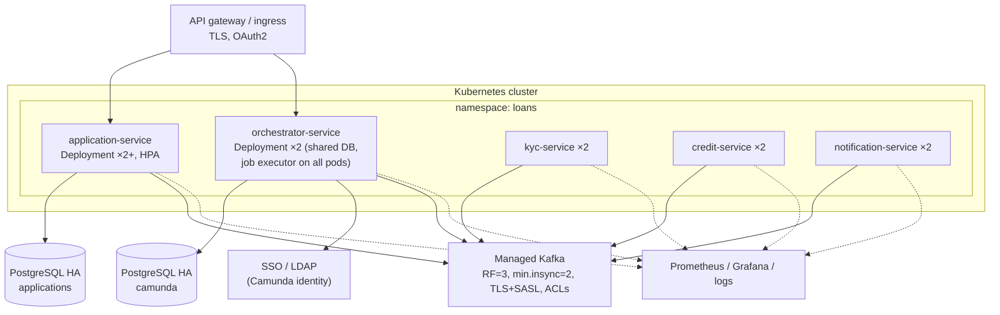

# 3. 4+1 architectural views

Kruchten's 4+1 model: four views, each for a different audience, tied together by scenarios (+1).

| View | Question it answers | Audience |
|---|---|---|
| [Logical](#31-logical-view) | What are the main abstractions and their relationships? | Developers, analysts |
| [Process](#32-process-view) | What runs concurrently, where are the transaction and wait boundaries? | Developers, SRE |
| [Development](#33-development-view) | How is the code organised and built? | Developers |
| [Physical](#34-physical-view) | What runs where? | Platform / SRE |
| [Scenarios](#35-scenarios-1) | Which use cases validate the views? | Everyone |

## 3.1 Logical view

Domain objects per bounded context. The `EventEnvelope` is the only type shared between contexts.

The **loan-origination process instance** is the fourth aggregate. It lives in Camunda, keyed by the same
application id, with these variables:

| Group | Variables | Set by |
|---|---|---|
| Application | `applicantName, nationalId, email, dateOfBirth, loanAmount, termMonths, annualIncome, purpose` | `LoanApplicationSubmitted` |
| KYC | `kycStatus, kycReason` | `KycCompleted` or KYC timeout |
| Credit | `creditStatus, creditScore, riskBand, debtToIncome, bureauReference` | `CreditCheckCompleted` or credit timeout |
| Decision | `riskDecision` | DMN |
| Underwriting | `underwritingApproved, underwriterComment` | Tasklist form |
| Tracing | `lastInboundEventId` | plug-in (becomes next `causationId`) |

## 3.2 Process view

### Transaction and wait-state boundaries in the BPMN

Every ⏸ is a committed wait state; every ⚡ is an async continuation executed by the job executor. Kafka
sends happen *after* the commit of the transaction they belong to.

| Tx | Triggered by | Work done | Commit then send |
|---|---|---|---|
| T1 | Kafka `LoanApplicationSubmitted` (listener thread) | create instance, fork, create 2 jobs | – |
| T2/T3 | job executor | send task → reach receive task (subscription) | `KycRequested` / `CreditCheckRequested` |
| T4/T5 | Kafka reply (listener thread) | set variables, create async-after job | – |
| T6/T7 | job executor | arrive at join (one waits, the other continues: DMN, gateway, next send/user task) | decision event |
| T8 | Tasklist complete | gateway, create publish job | – |

The parallel join is reached by two jobs that may run concurrently; Camunda's optimistic locking makes one fail
and the job executor retries it. This is why the receive tasks are `asyncAfter`.

### Concurrency model

- All events of one application land on one partition → processed in order by one thread.
- Parallelism = partitions (3 locally). Listener concurrency is 3 per service; more instances share the partitions.
- The orchestrator has a second pool: the Camunda **job executor** (async continuations, timers).
- The application service has a third: the **outbox scheduler** (single-threaded per instance; replicas
  co-operate through `SKIP LOCKED`).

## 3.3 Development view

- Only `orchestrator-service` (through the starter) depends on Camunda. Domain services depend only on
  `claybar-events`.
- Each library ships a Spring Boot auto-configuration (`META-INF/spring/...AutoConfiguration.imports`).
- One Maven reactor, versions from the Spring Boot parent and the `camunda-bom`.

| Path | Contents |
|---|---|
| `claybar-events/` | `EventEnvelope`, `Topics`, `EventTypes`, `EventCodec`, `EventPublisher`, error handler |
| `claybar-workflow-spring-boot-starter/` | plug-in (see C4 level 4) |
| `services/<name>/src/main/java/com/claybar/<name>/` | service code; application-service is split into `api`, `domain`, `outbox`, `messaging` |
| `services/orchestrator-service/src/main/resources/bpmn/` | BPMN + DMN, auto-deployed |
| `services/application-service/src/main/resources/db/migration/` | Flyway |
| `scripts/` | demo, BPMN layout generator |

Test pyramid: DMN table tests (pure, ms) → BPMN process tests (in-memory engine, manual job execution) →
Spring MVC/JPA tests (H2) → embedded-Kafka integration test → `make up && make demo` against the real stack.
CI (`.github/workflows/ci.yml`) runs `mvn verify` and builds one image per service.

## 3.4 Physical view

### Local / demo (docker compose)

Images: one `Dockerfile`, layered Spring Boot jar, JRE 21 Alpine, non-root user, `MaxRAMPercentage=75`.
Health: `/actuator/health/readiness` gates `docker compose up --wait`.

### Target production topology (proposed)

- Camunda 7 scales horizontally on a shared database (the job executor uses optimistic locking).
- Partitions per topic ≥ the max replicas of the consuming service.
- Probes: `/actuator/health/liveness` and `/readiness`; graceful shutdown (30 s) is configured.

## 3.5 Scenarios (+1)

Each scenario exercises all four views; the right-hand column says where it is verified.

| # | Scenario | Views touched | Verified by |
|---|---|---|---|
| S1 | Prime applicant auto-approved | logical (status), process (T1–T7), physical (all containers) | `primeApplicantIsAutoApproved`, `make demo` |
| S2 | Borderline case decided by underwriter | process (user task wait state), logical (variables) | `nearPrimeApplicantGoesToUnderwriterWhoRejects`, demo + REST completion |
| S3 | KYC provider silent → review | process (timer job) | `kycTimeoutRoutesToManualReview` |
| S4 | Sanctions hit → reject | logical (KycResult), DMN rule 1 | `failedKycIsRejectedWithoutUnderwriter`, demo |
| S5 | Kafka redelivers events | process (idempotency) | `redeliveredEventsAreIdempotent`, `decisionsAreProjectedIdempotently…` |
| S6 | Broker down while submitting | development (outbox), process (relay ordering) | `relayPublishesInOrderAndStopsAtFirstFailure` |
| S7 | Poison message | process (DLT path) | `poisonMessageIsDeadLettered` (embedded Kafka) |
| S8 | Underwriting SLA breached | process (non-interrupting timer), physical (notification) | live stack (compose SLA 5 min) |

Business-level narratives for these scenarios are in [Business flows](01-business-flows.md#16-scenarios).
