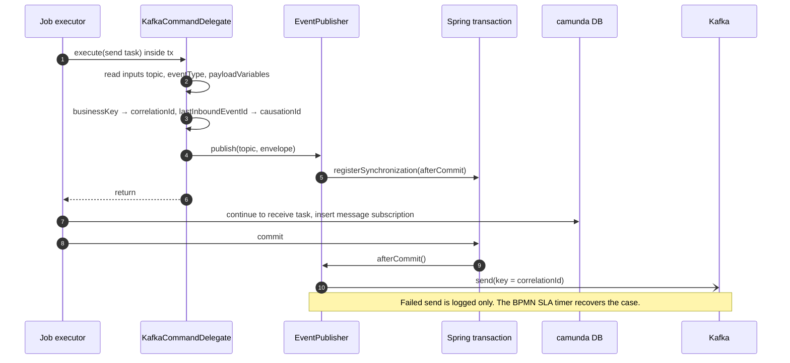
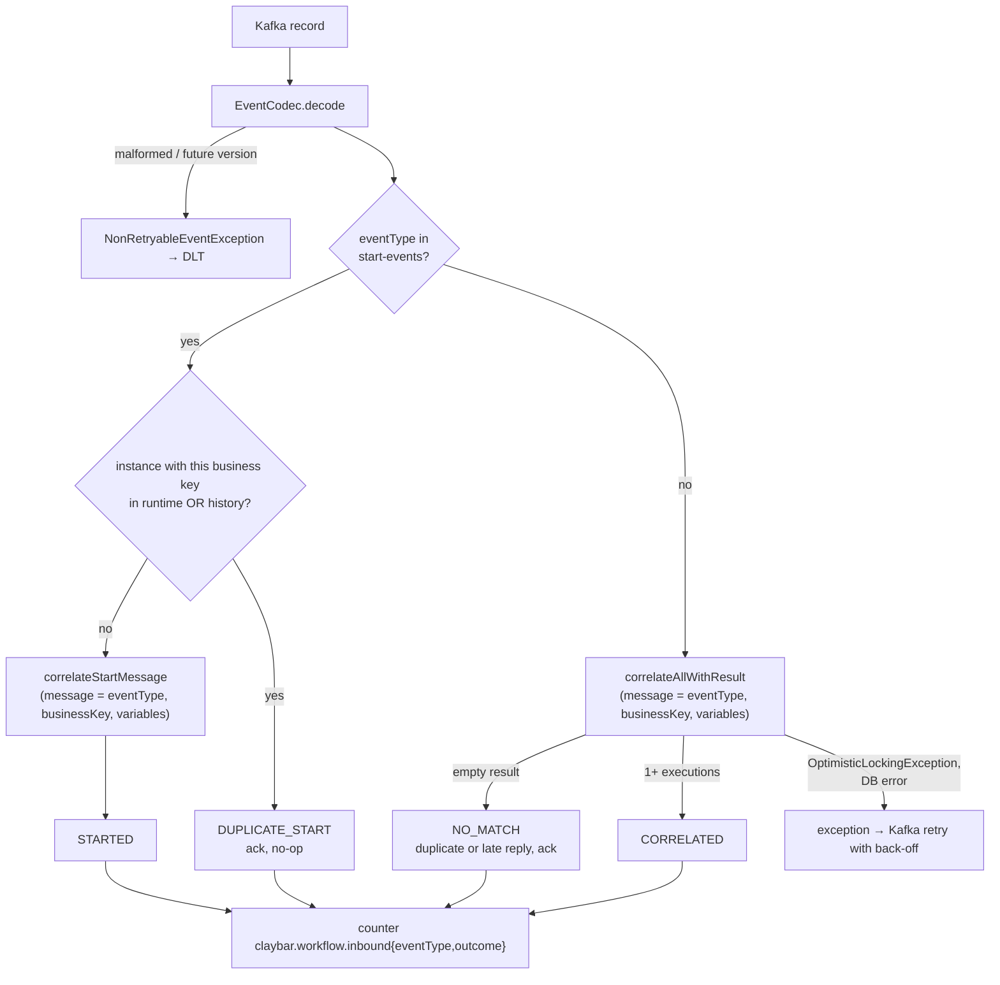
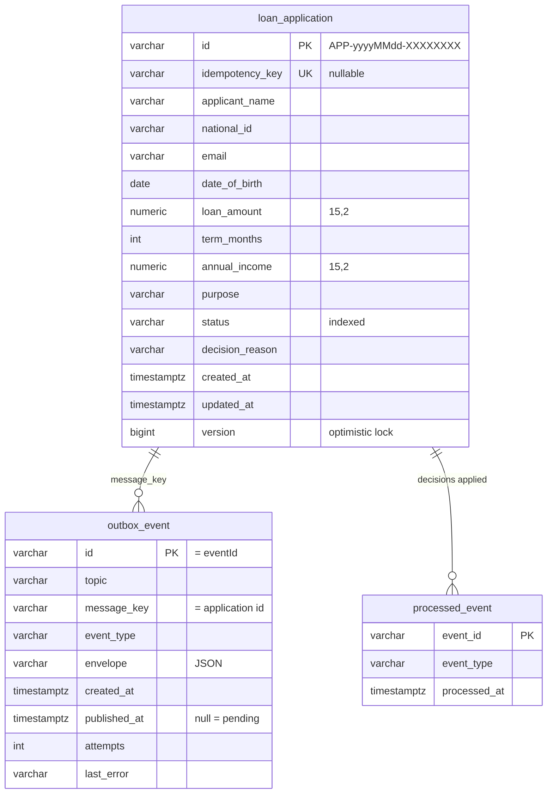
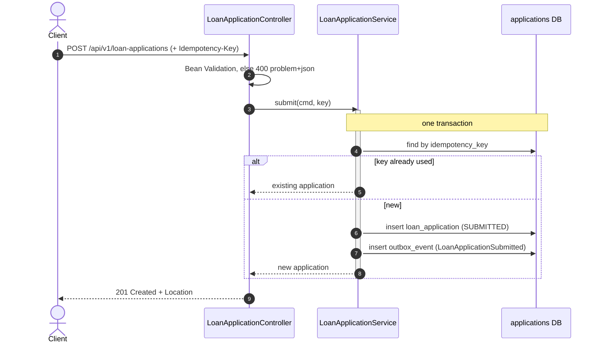
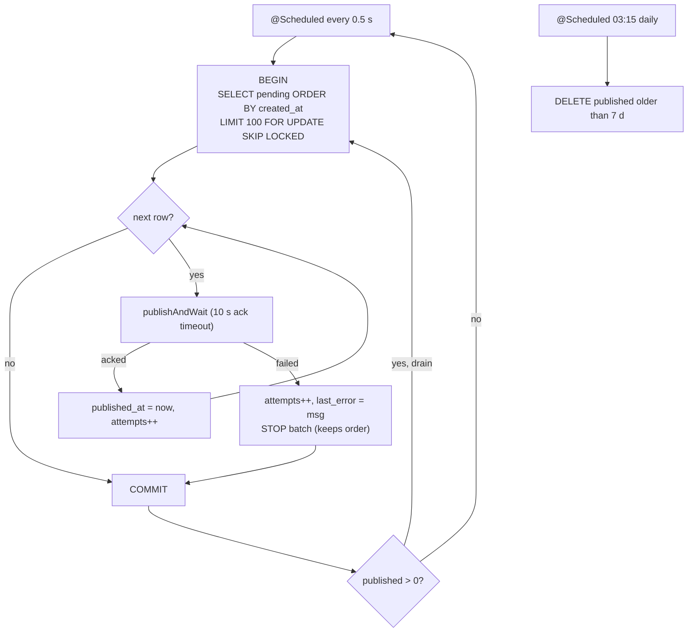

# 4. Low-level design

Component-level contracts and algorithms. Class and file names match the code so this page can be checked
against it.

## 4.1 Event contract

Every Kafka record value is one JSON `EventEnvelope` (`claybar-events`). Example:

```json
{
  "eventId": "8b5a9ac0-db70-4d54-bf7e-f04c6491d7d9",
  "eventType": "CreditCheckCompleted",
  "version": 1,
  "source": "credit-service",
  "correlationId": "APP-20261119-E132E71B",
  "causationId": "4f0c1e8a-2b7d-4e55-9a51-0d2c7e3b9f10",
  "occurredAt": "2026-11-19T23:03:32.480Z",
  "payload": { "creditStatus": "COMPLETED", "creditScore": 800, "riskBand": "PRIME",
               "debtToIncome": 0.222, "bureauReference": "BUR-1A2B3C4D" }
}
```

| Field | Rule |
|---|---|
| `eventId` | UUID, required. Consumers use it for idempotency. |
| `correlationId` | Required. Application id = Camunda business key = **Kafka record key**. |
| `causationId` | Id of the event that caused this one (`EventEnvelope.causedBy`). Chains replies to commands. |
| `version` | Payload schema version. `> CURRENT_VERSION` → `NonRetryableEventException` → DLT. |
| headers | `claybar-event-id`, `claybar-event-type`, `claybar-correlation-id`, `claybar-source` |

### Event catalogue

| Event | Topic | Producer | Payload |
|---|---|---|---|
| `LoanApplicationSubmitted` | loan.applications | application-service | applicantName, nationalId, email, dateOfBirth, loanAmount, termMonths, annualIncome, purpose? |
| `KycRequested` | kyc.commands | orchestrator | applicantName, nationalId, email, dateOfBirth, processInstanceId |
| `KycCompleted` | kyc.events | kyc-service | kycStatus (VERIFIED/FAILED/REFER), kycReason |
| `CreditCheckRequested` | credit.commands | orchestrator | applicantName, nationalId, annualIncome, loanAmount, termMonths, processInstanceId |
| `CreditCheckCompleted` | credit.events | credit-service | creditStatus, creditScore, riskBand, debtToIncome, bureauReference |
| `LoanUnderReview` | loan.decisions | orchestrator | riskDecision, creditScore, kycStatus |
| `LoanApproved` | loan.decisions | orchestrator | applicantName, email, loanAmount, termMonths, creditScore, riskDecision, underwriterComment? |
| `LoanRejected` | loan.decisions | orchestrator | applicantName, email, loanAmount, creditScore, kycStatus, kycReason, riskDecision, underwriterComment? |
| `UnderwritingSlaBreached` | loan.decisions | orchestrator | applicantName, loanAmount |
| `WorkflowProcessStarted/Ended` | workflow.events | engine plug-in | processInstanceId, processDefinitionKey, state, endActivityId, durationMillis |
| `WorkflowTaskCreated/Completed` | workflow.events | engine plug-in | taskId, taskDefinitionKey, taskName, assignee |
| `WorkflowIncidentCreated/Resolved` | workflow.events | engine plug-in | incidentType, activityId, incidentMessage |

Orchestrator-produced payloads always include `processInstanceId`. `?` = present only when the variable exists.

## 4.2 BPMN element specification (`loan-origination`)

| Element id | Type | Async | Implementation / configuration |
|---|---|---|---|
| `Start_LoanSubmitted` | message start | – | message `LoanApplicationSubmitted` |
| `Task_RequestKyc` | send task | before | `${kafkaCommandDelegate}` topic=`claybar.kyc.commands`, eventType=`KycRequested` |
| `Task_AwaitKyc` | receive task | after | message `KycCompleted` |
| `Timer_KycTimeout` | boundary timer, interrupting | – | `${loanSla.kycTimeout}` |
| `Task_KycTimedOut` | service task | – | `${true}` + outputs kycStatus=`TIMEOUT`, kycReason |
| `Task_RequestCredit` | send task | before | topic=`claybar.credit.commands`, eventType=`CreditCheckRequested` |
| `Task_AwaitCredit` | receive task | after | message `CreditCheckCompleted` |
| `Timer_CreditTimeout` | boundary timer, interrupting | – | `${loanSla.creditTimeout}` |
| `Task_CreditTimedOut` | service task | – | outputs creditStatus=`TIMEOUT`, creditScore=`0` |
| `Gateway_KycMerge`, `Gateway_CreditMerge` | XOR merge | – | joins normal and timeout path per branch |
| `Gateway_Join` | parallel join | – | |
| `Task_AssessRisk` | business rule task | – | DMN `loan-risk-assessment`, singleEntry → `riskDecision` |
| `Gateway_RiskDecision` | XOR | – | `${riskDecision == 'APPROVE' / 'REVIEW' / 'REJECT'}` |
| `Task_NotifyUnderReview` | send task | before | `LoanUnderReview` → loan.decisions |
| `UserTask_Underwrite` | user task | – | candidateGroups=`underwriters`, due=`${loanSla.underwritingDueDate()}`, form: underwritingApproved (bool, required), underwriterComment |
| `Timer_UnderwritingSla` | boundary timer, non-interrupting | – | `${loanSla.underwritingSla}` → `Task_EscalateSla` (`UnderwritingSlaBreached`) → `End_Escalated` |
| `Gateway_UwOutcome` | XOR | – | `${underwritingApproved}` |
| `Task_PublishApproved` / `Task_PublishRejected` | send task | before | `LoanApproved` / `LoanRejected` → loan.decisions |

Process `historyTimeToLive = P180D`. The model is generated by `scripts/generate-loan-origination-bpmn.py`
(includes the diagram layout); edit either the script or the `.bpmn` in Camunda Modeler.

## 4.3 Outbound: `KafkaCommandDelegate` + `EventPublisher`



## 4.4 Inbound: `WorkflowEventCorrelator.handle`



Variable mapping (`ProcessVariableMapper`): String/Boolean/Integer/Long/Double unchanged; BigDecimal → Double;
BigInteger → Long; Map/Collection → JSON string; anything else → `toString()`. `processInstanceId` is dropped;
`lastInboundEventId` is added.

## 4.5 Engine lifecycle plug-in

`ClaybarKafkaEventsProcessEnginePlugin.preInit` appends a `LazyHistoryEventHandler` to
`customHistoryEventHandlers` and keeps the default DB handler. The real `KafkaLifecycleHistoryEventHandler` is
built on first event (avoids pulling Kafka beans into engine bootstrap).

| History event | Emitted as | Business key source |
|---|---|---|
| `PROCESS_INSTANCE_START/END` | `WorkflowProcessStarted/Ended` | event entity |
| `TASK_INSTANCE_CREATE/COMPLETE` | `WorkflowTaskCreated/Completed` | execution lookup in current command context |
| `INCIDENT_CREATE/RESOLVE` | `WorkflowIncidentCreated/Resolved` | execution lookup |
| anything else | ignored | – |

The handler catches every exception: lifecycle streaming must never roll back an engine transaction.

## 4.6 application-service

### Data model (Flyway `V1__loan_applications.sql`)



### Submit (write path)



A concurrent duplicate key violates the unique index → `DataIntegrityViolationException` → **409**; the client retries
and gets the original.

### Outbox relay (`OutboxScheduler` → `OutboxRelay.relayBatch`)



Gauge `claybar.outbox.pending` = rows with `published_at IS NULL`. Alert if it grows.

### Decision projection (`LoanDecisionProjector`)

One transaction per record: if `processed_event` has the `eventId` → skip; else map type → status
(`LoanUnderReview`→UNDER_REVIEW, `LoanApproved`→APPROVED, `LoanRejected`→REJECTED), call
`LoanApplication.transitionTo` (no-op if already final), insert `processed_event`. Reason = first non-blank of
`underwriterComment`, `kycReason`, else `"Risk decision: <riskDecision>"`.

### REST API

| Method & path | Success | Errors |
|---|---|---|
| `POST /api/v1/loan-applications` | 201, `Location`, body = application view | 400 (field errors in `errors`), 409 (concurrent same key) |
| `GET /api/v1/loan-applications/{id}` | 200 | 404 |

Validation: name ≤ 200, email format, `dateOfBirth` in the past, 1,000 ≤ `loanAmount` ≤ 1,000,000,
6 ≤ `termMonths` ≤ 360, `annualIncome` ≥ 0. The response never contains `nationalId` or `dateOfBirth`.
OpenAPI: `/v3/api-docs`, Swagger UI `/swagger-ui.html`.

## 4.7 Domain services

| Service | Listener | Logic | Reply |
|---|---|---|---|
| kyc-service | `KycCommandListener` on kyc.commands (`KycRequested` only) | `KycScreeningService.screen`: missing name/id → FAILED; sanctions list (accent/case/space-insensitive) → FAILED; age < 18 or bad date → FAILED; PEP list → REFER; else VERIFIED | `KycCompleted` via `publishAndWait` |
| credit-service | `CreditCommandListener` on credit.commands | `CreditBureauClient` (simulated): score = CRC32(nationalId) mod 551 + 300, demo prefixes PRIME/NEAR/SUB → 800/650/480; band ≥700 PRIME, ≥600 NEAR_PRIME; DTI = amount/income. Missing nationalId → poison | `CreditCheckCompleted` via `publishAndWait` |
| notification-service | `NotificationListener` on loan.decisions + workflow.events | `NotificationComposer` maps Approved/Rejected → EMAIL to applicant; UnderReview, SlaBreached, IncidentCreated → OPS_ALERT; dedupe by `ProcessedEventCache` (LRU 10k) | `NotificationSender` (logging adapter) |

`publishAndWait` blocks the listener until the broker acks; the offset is only committed afterwards, so a failed
reply means redelivery and recomputation, never a lost reply. Both computations are deterministic.

## 4.8 Error handling matrix

| Failure | Where | Handling | Outcome |
|---|---|---|---|
| Malformed JSON, missing `eventId`/`correlationId`, future version | any consumer | `NonRetryableEventException` | DLT at once |
| Missing mandatory payload field (e.g. nationalId) | credit-service | `NonRetryableEventException` | DLT; process hits SLA timer |
| Broker unavailable on reply | kyc/credit | `publishAndWait` throws | retry 1 s/2 s/4 s → DLT |
| Optimistic locking in engine | orchestrator listener | exception propagates | Kafka retry |
| Optimistic locking at parallel join | job executor | Camunda job retry | transparent |
| Delegate/DMN exception | job executor | 3 job retries → **incident** | Cockpit + `WorkflowIncidentCreated` → ops alert |
| Reply with no waiting instance | orchestrator | `NO_MATCH` | ack, warn log, metric |
| Kafka send fails after engine commit | orchestrator | logged | SLA timer → review |
| Kafka down during submit | application-service | outbox keeps row | relayed when broker returns |

DLT records keep the original partition and carry Spring's `kafka_dlt-*` headers (exception class, message,
original topic/offset).

## 4.9 Configuration and metrics

| Property | Default | Service |
|---|---|---|
| `claybar.loan.sla.kyc-timeout` / `credit-timeout` / `underwriting-sla` | PT10M / PT10M / P2D | orchestrator |
| `claybar.workflow.*` | see [plug-in guide](../plugin-guide.md) | orchestrator |
| `claybar.kafka.retry.max-attempts` / `initial-interval` / `max-interval` | 3 / 1s / 10s | all |
| `claybar.kafka.create-topics`, `partitions`, `replication-factor` | true, 3, 1 | all |
| `claybar.outbox.poll-interval`, `batch-size`, `send-timeout`, `retention` | PT0.5S, 100, 10s, 7d | application |
| `claybar.kyc.minimum-age`, `sanctioned-names`, `politically-exposed-names` | 18, demo lists | kyc |
| `claybar.credit.simulated-latency` | 0ms | credit |
| `claybar.notification.ops-recipient`, `dedupe-cache-size` | loan-ops@…, 10000 | notification |
| `claybar.security.engine-rest.basic-auth` | true | orchestrator |
| `claybar.demo.seed-identities` | true (set false in prod) | orchestrator |

| Metric | Type | Tags |
|---|---|---|
| `claybar.workflow.inbound` | counter | eventType, outcome |
| `claybar.outbox.pending` | gauge | – |
| `claybar.kyc.screenings` | counter | status |
| `claybar.credit.bureau.latency` | timer (histogram) | – |
| `claybar.notifications.sent` | counter | channel, eventType |

Plus the standard Spring Kafka, JVM, HikariCP and HTTP metrics at `/actuator/prometheus`. Every log line carries
`[service, correlationId]` (MDC set by `CorrelationContext`).

## 4.10 Security

| Surface | Control |
|---|---|
| Camunda REST `/engine-rest/*` | HTTP Basic via `ProcessEngineAuthenticationFilter` → Camunda authorizations |
| Camunda webapps | Camunda login; `underwriters` group for the user task |
| Application API | Unauthenticated in this repo; front with gateway + OAuth2 in production |
| Process variables | No Java serialisation (`javaSerializationFormatEnabled=false`) |
| PII | National id / DOB not returned by the API; present in Kafka payloads → encrypt topics at rest, restrict ACLs |
| Containers | Non-root user, JRE-only image, secrets via env vars |
